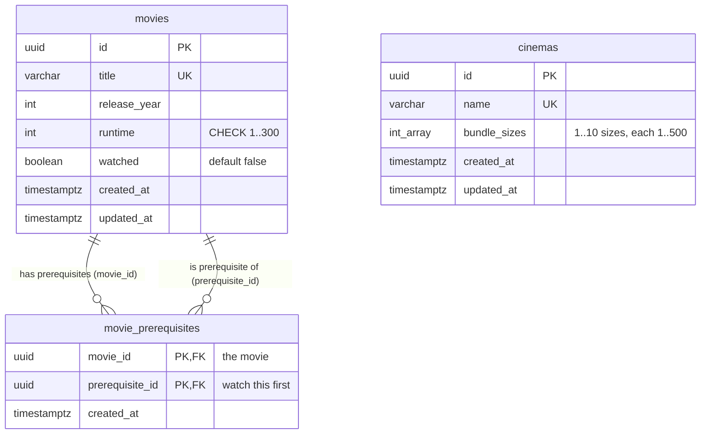

# Doomsday Ready — Backend

A NestJS + Prisma + PostgreSQL API that helps MCU fans plan their rewatch before
**Avengers: Doomsday** and book an opening-night watch party.

- **Feature 1 — Movies & Rewatch Order:** movies with prerequisites, circular-dependency protection, and an ordered rewatch plan.
- **Feature 2 — Cinemas & Booking:** the fewest seat bundles that add up to exactly the group size.

Tech: NestJS 12, Prisma 7 (`@prisma/adapter-pg`), PostgreSQL, class-validator, Vitest.

---

## Quick start

### Option A — Docker (one command)

```bash
docker compose up --build
```

This starts Postgres and the API on http://localhost:3000/api, applies migrations, and seeds the sample data.

### Option B — Local

```bash
bun install
cp .env.example .env        # then set DATABASE_URL
bun run prisma:generate
bun run db:migrate          # apply migrations
bun run db:seed             # 8 sample MCU movies + 3 cinemas (safe to re-run)
bun run start:dev           # http://localhost:3000/api
```

### Tests

```bash
bun run test        # unit tests: rewatch order, cycle detection, booking quote
bun run test:e2e    # HTTP tests: validation, 409 CIRCULAR_DEPENDENCY, booking (no DB needed)
```

---

## API

All endpoints live under `/api`.

| Method | Path | Purpose |
| --- | --- | --- |
| `GET` | `/health` | Health & database connectivity check |
| `POST` | `/movies` | Create a movie |
| `GET` | `/movies` | List movies |
| `PATCH` | `/movies/:id` | Update a movie (incl. `watched` and `prerequisiteIds`) |
| `GET` | `/movies/:id/rewatch-order` | Rewatch order (Feature 1) |
| `POST` | `/cinemas` | Create a cinema |
| `GET` | `/cinemas` | List cinemas |
| `GET` | `/cinemas/:id/booking?groupSize=6` | Booking quote (Feature 2) |

### Movies

```jsonc
// POST /api/movies
{
  "title": "The Avengers",          // unique
  "releaseYear": 2012,
  "runtime": 143,                    // minutes, 1–300
  "watched": false,                  // optional, default false
  "prerequisiteIds": ["<uuid>", "<uuid>"]  // optional
}
```

`PATCH /api/movies/:id` accepts any subset of these fields. Sending `prerequisiteIds` **replaces** the whole list.

```jsonc
// GET /api/movies/:id/rewatch-order
{
  "target": { "id": "…", "title": "Captain America: Civil War", … },
  "movies": [ { "title": "Iron Man", … }, { "title": "Captain America: The First Avenger", … }, { "title": "The Avengers", … } ],
  "totalCount": 3,
  "watchedCount": 1,
  "unwatchedRuntime": 267
}
```

### Cinemas

```jsonc
// POST /api/cinemas
{ "name": "Avengers Multiplex", "bundleSizes": [2, 5] }   // 1–10 unique sizes, each 1–500

// GET /api/cinemas/:id/booking?groupSize=11     (groupSize 1–10,000)
{ "cinema": { … }, "possible": true, "groupSize": 11, "totalBundles": 4,
  "bundles": [ { "size": 5, "count": 1 }, { "size": 2, "count": 3 } ] }

// When no exact combination exists:
{ "cinema": { … }, "possible": false, "groupSize": 7, "totalBundles": 0, "bundles": [],
  "message": "Not possible: no combination of bundles adds up to exactly this group size." }
```

### Errors

Every error has the same shape:

```json
{ "statusCode": 409, "code": "CIRCULAR_DEPENDENCY", "message": "…", "path": "/api/movies/…", "timestamp": "…" }
```

| Status | `code` | When |
| --- | --- | --- |
| 400 | `BAD_REQUEST` | Validation failed (`message` lists every problem), unknown fields, unknown prerequisite IDs |
| 404 | `NOT_FOUND` | Movie or cinema doesn't exist |
| 409 | `CIRCULAR_DEPENDENCY` | A movie would depend on itself, directly or through other movies |
| 409 | `UNIQUE_CONSTRAINT_VIOLATION` | Duplicate movie title or cinema name |

---

## Data model



- **Prerequisites** are a self-referencing many-to-many relation, stored in an explicit join table.
  The composite primary key stops duplicate links, and a `CHECK (movie_id <> prerequisite_id)` blocks direct self-links at the database level.
- **Bundle sizes** are a Postgres `int[]` on the cinema. They're always read together with the cinema and never queried on their own, so a separate table would only add joins.

---

## How the two algorithms work

Both are hand-written, without libraries that solve them, as the brief requires.

**Rewatch order** ([`rewatch-order.ts`](src/movies/rewatch-order.ts)): depth-first search.
To "visit" a movie, first visit all of its prerequisites, then add the movie to the list.
A `visited` set makes sure each movie appears once and excludes the target. Prerequisites are visited oldest-first, so the output is stable.
For Avengers: Doomsday this produces exactly the brief's example order. Time is `O(movies + links)`.

**Cycle detection** (same file): before saving new prerequisites for movie X, walk from each new prerequisite through *their* prerequisites.
If the walk reaches X, saving would create a loop, so the API returns `409 CIRCULAR_DEPENDENCY`.
This runs inside a serializable transaction, so two concurrent updates can't create a cycle together.

**Booking quote** ([`booking-quote.ts`](src/cinemas/booking-quote.ts)): dynamic programming, the classic "coin change" problem.
`minBundles[n]` is the fewest bundles that add up to exactly `n` seats: `minBundles[n] = 1 + min(minBundles[n − size])`.
We remember which size was picked at each step to rebuild the answer.
Greedy would be wrong here: for `[1,3,4]` and 6, greedy picks 4+1+1, but the best is 3+3.
Time is `O(groupSize × sizes)`, at most 100,000 steps.

---

## Assumptions & decisions

- **"Release year and runtime in minutes: 1–300":** I read the 1–300 range as applying to runtime only. Release year is validated as an integer between 1888 (the first film) and 2100.
- **Creating a movie can't cause a cycle**, because nothing depends on a brand-new movie yet. Cycle checks therefore run on update.
- **`prerequisiteIds` on PATCH replaces the list** rather than adding to it, which keeps the "edit prerequisites" UI simple.
- **Unknown prerequisite IDs → 400**, not 404, because the problem is in the request body.
- **Ties in the booking quote:** when two answers use the same number of bundles, larger bundles are preferred.
- **IDs are UUIDs.** Non-UUID IDs in the URL return 400.
- **Sample runtimes** in the seed are approximate. Avengers: Doomsday uses a placeholder of 150 minutes.

---

## Project structure

```
prisma/
  schema.prisma          data model
  migrations/            SQL migrations (incl. CHECK constraints)
  seed.ts                sample MCU movies + cinemas
src/
  app.setup.ts           /api prefix, CORS, ValidationPipe, filter, interceptor
  common/                exception filter, logging interceptor, CircularDependencyException
  prisma/                PrismaService (Prisma 7 + pg adapter) as a global module
  movies/                controller, service, DTOs, rewatch-order.ts (+ tests)
  cinemas/               controller, service, DTOs, booking-quote.ts (+ tests)
test/
  api.e2e-spec.ts        HTTP-level tests
```

---

## How I used AI tools

<!-- TODO: edit this section in your own words before submitting. -->

I used an AI coding assistant during development to:

- Talk through the database design (join table vs. array for prerequisites and bundle sizes).
- Scaffold NestJS boilerplate: modules, DTOs, the exception filter and the logging interceptor.
- Review and simplify my code, and write test cases from the brief's expected results.

I reviewed, ran and tested all of the code myself. I can explain every part, especially the rewatch-order DFS, the cycle check and the booking DP.
