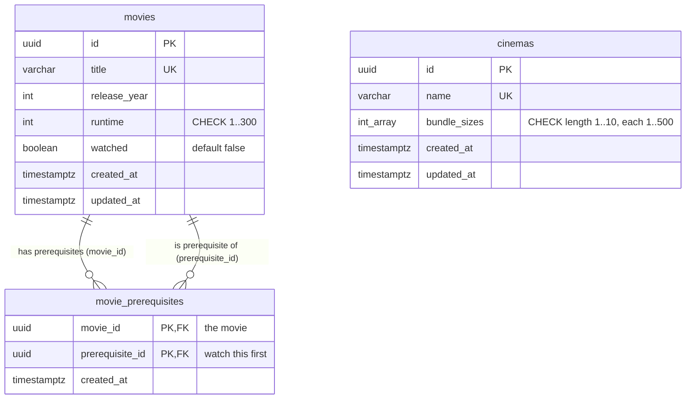

# Doomsday Ready — Full-Stack Application

A full-stack web application (**NestJS + Prisma 7 + PostgreSQL + React + Vite + Tailwind CSS v4**) that helps MCU fans plan their rewatch before **Avengers: Doomsday** and book an opening-night watch party.

- **Feature 1 — Movies & Rewatch Order:** Create/edit MCU movies with prerequisites, enforce direct & transitive circular-dependency protection (`409 CIRCULAR_DEPENDENCY`), and compute a valid rewatch order with watched count and remaining runtime.
- **Feature 2 — Cinemas & Watch-Party Booking:** Manage cinemas with opening-night seat bundles (1–10 sizes, 1–500 seats each) and calculate the minimum number of bundles that add up to an exact group size (1–10,000), or report when no exact combination exists.
- **Feature 3 — React Frontend:** Responsive 3-page React Router web app (**Movies**, **Rewatch Plan**, **Watch-Party Booking**) powered by Axios and Tailwind CSS v4.

**Tech Stack:** NestJS 12, Prisma 7 (`@prisma/adapter-pg`), PostgreSQL, class-validator, Vitest, React 19, React Router, Axios, Vite 8, Tailwind CSS v4.

---

## Quick Start

### Option A — Docker Compose (One Command)

```bash
docker compose up --build
```

Starts all three services together:
- **PostgreSQL 17** on port `5432`
- **Backend API** on `http://localhost:3000/api` (automatically applies migrations and seeds sample MCU data)
- **React Frontend** on `http://localhost:5173`

### Option B — Local Development

```bash
# 1. Install backend & frontend dependencies
bun install
cd frontend && bun install && cd ..

# 2. Configure environment variables
cp .env.example .env            # set DATABASE_URL

# 3. Generate Prisma client, apply migrations, and seed sample data
bun run prisma:generate
bun run db:migrate              # apply SQL migrations + CHECK constraints
bun run db:seed                 # 8 sample MCU movies + 3 cinemas (idempotent)

# 4. Run Backend + Frontend together in one command
bun run dev
```

- **Frontend:** `http://localhost:5173`
- **Backend API:** `http://localhost:3000/api`
- **Health Check:** `http://localhost:3000/api/health` (or `/health`)

### Tests

```bash
bun run test        # unit tests: rewatch order, cycle detection, booking quote DP
bun run test:e2e    # HTTP integration tests: validation, 409 CIRCULAR_DEPENDENCY, booking, health
```

---

## API Reference

All endpoints live under `/api`.

| Method | Path | Purpose |
| --- | --- | --- |
| `GET` | `/health` | Health & PostgreSQL connectivity check (also at `GET /health`) |
| `POST` | `/movies` | Create a movie |
| `GET` | `/movies` | List movies |
| `PATCH` | `/movies/:id` | Update a movie (including `watched` and `prerequisiteIds`) |
| `GET` | `/movies/:id/rewatch-order` | Rewatch order, watched count & unwatched runtime (Feature 1) |
| `POST` | `/cinemas` | Create a cinema |
| `GET` | `/cinemas` | List cinemas |
| `GET` | `/cinemas/:id/booking?groupSize=6` | Optimal seat bundle quote (Feature 2) |

### Movies

```jsonc
// POST /api/movies
{
  "title": "The Avengers",                 // unique
  "releaseYear": 2012,
  "runtime": 143,                          // minutes, 1–300
  "watched": false,                        // optional, default false
  "prerequisiteIds": ["<uuid>", "<uuid>"]  // optional
}
```

`PATCH /api/movies/:id` accepts any subset of these fields. Providing `prerequisiteIds` **replaces** the movie's prerequisite list inside a serializable transaction after verifying no circular dependency is created.

```jsonc
// GET /api/movies/:id/rewatch-order
{
  "target": { "id": "…", "title": "Captain America: Civil War", … },
  "movies": [
    { "title": "Iron Man", … },
    { "title": "Captain America: The First Avenger", … },
    { "title": "The Avengers", … }
  ],
  "totalCount": 3,
  "watchedCount": 1,
  "unwatchedRuntime": 267
}
```

### Cinemas

```jsonc
// POST /api/cinemas
{ "name": "Avengers Multiplex", "bundleSizes": [2, 5] }   // 1–10 unique sizes, each 1–500

// GET /api/cinemas/:id/booking?groupSize=11               // groupSize 1–10,000
{
  "cinema": { … },
  "possible": true,
  "groupSize": 11,
  "totalBundles": 4,
  "bundles": [ { "size": 5, "count": 1 }, { "size": 2, "count": 3 } ]
}

// When no exact combination exists:
{
  "cinema": { … },
  "possible": false,
  "groupSize": 7,
  "totalBundles": 0,
  "bundles": [],
  "message": "Not possible: no combination of bundles adds up to exactly this group size."
}
```

### Standardized Errors

Every error response uses the same JSON format:

```json
{
  "statusCode": 409,
  "code": "CIRCULAR_DEPENDENCY",
  "message": "A movie cannot depend on itself, directly or through other movies.",
  "path": "/api/movies/…",
  "timestamp": "…"
}
```

| Status | `code` | When |
| --- | --- | --- |
| `400` | `BAD_REQUEST` | DTO validation failure, unknown fields, invalid UUID, or non-existent prerequisite IDs |
| `404` | `NOT_FOUND` | Movie or cinema ID does not exist |
| `409` | `CIRCULAR_DEPENDENCY` | A movie would depend on itself directly or through other movies |
| `409` | `UNIQUE_CONSTRAINT_VIOLATION` | Duplicate movie title or cinema name |

---

## Data Model



- **`movie_prerequisites` (self-referencing many-to-many):** Explicit join table with a composite primary key `(movie_id, prerequisite_id)` preventing duplicates and a PostgreSQL `CHECK (movie_id <> prerequisite_id)` blocking direct self-loops at the database level.
- **`cinemas.bundle_sizes` (`INTEGER[]`):** Stored directly on `cinemas` with a `CHECK (array_length(bundle_sizes, 1) BETWEEN 1 AND 10)` constraint since bundle sizes are always read alongside their cinema.

---

## Core Algorithms (Hand-Written)

Both Feature 1 and Feature 2 algorithms are implemented directly in TypeScript without external graph or optimization libraries:

1. **Rewatch Order** ([`src/movies/rewatch-order.ts`](src/movies/rewatch-order.ts)):
   - Post-order depth-first search (`computeRewatchOrder`). Before adding a movie to the watch list, all of its prerequisites are visited first. A `visited` set ensures every movie appears exactly once and excludes the target itself. Prerequisites are sorted by `releaseYear` then `title` for deterministic output. Time complexity: `O(V + E)`.
2. **Circular Dependency Detection** ([`src/movies/rewatch-order.ts`](src/movies/rewatch-order.ts)):
   - Before updating prerequisites for movie `X`, `wouldCreateCycle` traverses the prerequisite graph starting from each candidate prerequisite. If `X` is reachable, the update is rejected with `409 CIRCULAR_DEPENDENCY`. Executed inside a `Serializable` Prisma transaction to prevent concurrent race conditions.
3. **Watch-Party Booking Quote** ([`src/cinemas/booking-quote.ts`](src/cinemas/booking-quote.ts)):
   - Bottom-up dynamic programming (`computeBookingQuote`, unbounded minimum coin change). `minBundles[n]` stores the fewest bundles summing to exactly `n` seats, and `lastBundle[n]` tracks the chosen size to reconstruct exact counts. Handles non-greedy cases like `[1, 3, 4]` for `6` (`3 × 2` instead of `4 + 1 + 1`). Time complexity: `O(groupSize × bundleSizes.length)` (at most 100,000 steps).

---

## Assumptions & Design Decisions

- **"Release year and runtime in minutes: 1–300":** Interpreted `1–300` as applying to `runtime` in minutes; `releaseYear` is validated as an integer in `1888–2100`.
- **Creating a movie cannot form a cycle:** A newly created movie has no dependents yet, so cycle detection runs on `PATCH /api/movies/:id`.
- **`PATCH /api/movies/:id` replaces `prerequisiteIds`:** Passing `prerequisiteIds` replaces the movie's entire prerequisite set, keeping prerequisite editing straightforward in the UI.
- **Unknown prerequisite IDs return `400 BAD_REQUEST`:** Invalid references in the request body return `400`.
- **Tie-breaking in booking quotes:** When multiple solutions use the same minimum bundle count, larger bundle sizes are preferred.
- **Sample runtimes:** Approximate MCU runtimes are seeded, with *Avengers: Doomsday* using a placeholder runtime of 150 minutes.

---

## Project Structure

```text
api/
  index.ts                   Vercel serverless NestJS entrypoint
prisma/
  schema.prisma              Database models
  migrations/                SQL migrations (including CHECK constraints)
  seed.ts                    Idempotent seeder (8 MCU movies + 3 cinemas)
src/
  app.setup.ts               /api prefix, CORS, ValidationPipe, filter, interceptor
  common/                    AllExceptionsFilter, LoggingInterceptor, CircularDependencyException
  prisma/                    Global PrismaService (Prisma 7 + @prisma/adapter-pg)
  health/                    GET /api/health & GET /health database check
  movies/                    Movies module, DTOs, hand-written DFS & cycle detection (+ tests)
  cinemas/                   Cinemas module, DTOs, hand-written booking DP (+ tests)
test/
  api.e2e-spec.ts            HTTP integration tests
frontend/
  src/
    api/client.ts            Axios client & API helpers
    types/index.ts           Shared TypeScript types
    components/              Navbar, Loader / Spinner
    layouts/MainLayout.tsx   Shared app shell with React Router <Outlet />
    pages/                   MoviesPage, RewatchPlanPage, BookingPage
docker-compose.yml           One-command Postgres + API + Frontend stack
vercel.json                  Full-stack Vercel deployment configuration
```

---

## How I Used AI Tools

I used an AI coding assistant during development to:

- Discuss database schema trade-offs (explicit join table for prerequisites, PostgreSQL `CHECK` constraints, and Prisma 7 driver adapter configuration).
- Scaffold NestJS modules, DTOs, global exception filter, logging interceptor, Dockerfiles, and React + Tailwind CSS frontend components.
- Review code readability, simplify logic, and expand unit and e2e test coverage against all expected results in the brief.

I reviewed, ran, and tested all backend endpoints, algorithms, and frontend flows myself and understand how every part works.
